> Note: this file came from the first planning package. Old "doc NN" numbers, "T-" task IDs and Figma mentions are out of date. The task list is in ROADMAP.md. Design is built in code (see DESIGN_SYSTEM.md). Project folders are simpler now: src/contracts and src/components/ui.

# 21 - CI/CD and Environment Strategy

| Field | Value |
|---|---|
| Doc ID | DOC-21 |
| Version / Date | 0.1.0 / 2026-10-15 |
| Owner | R5 DevOps/QA (R2 backup) |
| Status | Proposed |

## 1. Reproducible local setup
`pnpm install` → `pnpm supabase start` (Docker) → `pnpm db:reset` → `pnpm dev`. `.env.example` documents all variables (no real values). Node version pinned via `.nvmrc`/`engines`. One-command check: `pnpm verify` = format check + lint + typecheck + unit + db tests + build.

## 2. Environments
| Env | Purpose | Data | Deploy | Secrets |
|---|---|---|---|---|
| Local | Dev | Fake seed | manual | `.env.local` (git-ignored) |
| CI | Automated tests | Ephemeral | on PR | GitHub Actions secrets (minimal) |
| Preview | Per-PR UI review | Fake (staging DB or branch DB) | auto per PR | Preview secrets |
| Staging | Pre-prod validation | Fake only | auto on merge to `main` | Staging secrets |
| Production | Real users | Real | manual promote with approval | Production secrets (limited access R2/R5) |
**Parity:** same migrations, same Node/runtime, same config shape; differences only in secrets, scale, and data. **Prevention of prod data in dev:** no prod DB credentials outside prod; no prod dumps to laptops; any needed repro uses synthetic data.

## 3. Pipeline (GitHub Actions)

```mermaid
flowchart LR
  PR[Pull request] --> A[Format + lint + typecheck]
  A --> B[Unit + component tests]
  B --> C[Start Supabase, apply migrations, pgTAP]
  C --> D[Integration + contract tests]
  D --> E[Build]
  E --> F[Playwright smoke + axe]
  F --> G[Secret scan + audit + CodeQL]
  G --> H[Preview deploy]
  H --> M{Review approved?}
  M -->|yes| Main[Merge to main] --> Stg[Deploy staging + migrate] --> Smoke[Staging smoke] --> Prod{Release approval} --> P[Deploy production + migrate] --> PS[Prod smoke]
```

Required checks block merge. Nightly: full e2e (multi-browser), dependency audit, backup restore test (once per week).

## 4. Configuration and secrets
Validated at boot with Zod (`env.ts`): missing/invalid → app refuses to start. Secrets rotated on member departure, incident, or every 90 days. Different keys per environment. Supabase service-role key only in server env for allowlisted jobs.

## 5. Migrations in pipeline
CI: apply all from scratch + pgTAP; staging: apply on deploy; production: **snapshot first**, apply in release job, verify with smoke tests; destructive migrations need R2 + R5 approval.

## 6. Deployment approvals, rollback, release notes
- Production deploy requires: green staging smoke, release checklist signed (doc 23), release owner approval (see governance rule).
- Rollback: redeploy previous build (hosting-level instant rollback) + feature flags off; DB changes are forward-compatible (expand/contract) so code rollback works without DB restore; DB restore only for data corruption.
- Release notes: auto-drafted from Conventional Commits; human-edited; appended to `CHANGELOG.md`; "Known limitations" section mandatory.

## 7. Branching and integration
GitHub Flow (ADR-008). `main` protected: PR required, 1 approving review (2 for security-sensitive), required checks, no force push, linear history (squash merge). Branches ≤ 1 day; rebase on `main` at least twice daily. Feature flags per tenant for incomplete work. Tags `v0.x.y` at each staging/prod release.

## 8. Cost-aware CI
Cache pnpm store; run e2e only on changed areas for PRs when possible; check provider minute limits (doc 12).

## 9. Decisions to record
D-11 hosting; whether to use Supabase branching (paid) vs a shared staging project (free) - **default: one shared staging project, reset via seed**.
