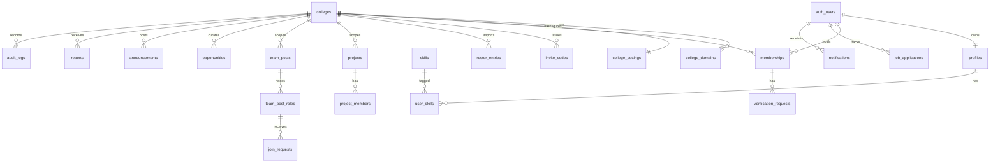

> Note: this file came from the first planning package. Old "doc NN" numbers, "T-" task IDs and Figma mentions are out of date. The task list is in ROADMAP.md. Design is built in code (see DESIGN_SYSTEM.md). Project folders are simpler now: src/contracts and src/components/ui.

# 13 - Data Model and Database

| Field | Value |
|---|---|
| Doc ID | DOC-13 |
| Version / Date | 0.1.0 / 2026-10-15 |
| Owner | R2 Tech Lead (migration owner). **Only R2 merges migrations; R5 backs up.** |
| Status | Proposed. Migration 0001 (`supabase/migrations/20261031000000_tenancy_identity_audit.sql`) implements colleges, college_domains, college_settings, profiles, memberships and audit_logs. Other tables are still design only. See section 11 for choices made while implementing. |
| Conventions | snake_case; `uuid` PKs (`gen_random_uuid()`); `created_at timestamptz default now()`, `updated_at` via trigger; soft delete via `deleted_at` only where noted; money in integer paise; enums as Postgres enums or `text` + CHECK (decision: **text + CHECK** for easier migration); every tenant-scoped table has `college_id uuid not null references colleges(id)` and **RLS enabled**. |

## 1. Entity relationship overview (P0/P1 core)

## 2. Tables - P0/P1 (full definition)
`FK` = foreign key; `UQ` = unique; `IDX` = index.

### 2.1 Tenancy and identity
**colleges**: `id` PK · `slug` text UQ (lowercase `[a-z0-9-]{3,40}`, reserved words blocked) · `name` text not null (≤120) · `short_name` text · `city`,`state` text · `country` text default 'IN' · `timezone` text default 'Asia/Kolkata' · `status` text CHECK in (`draft`,`active`,`suspended`,`archived`) · `logo_path` text · `accent_hex` text CHECK `^#[0-9A-Fa-f]{6}$` · `created_by` uuid · timestamps.
**college_domains**: `id` · `college_id` FK · `domain` text UQ (lowercase, no `@`) · `verified_at` · IDX(`college_id`). *A domain belongs to exactly one tenant.*
**college_settings**: `college_id` PK/FK · `allowed_methods` text[] (subset of `email_domain`,`invite_code`,`manual`,`roster`,…) · `require_admin_approval` bool default true · `min_level_to_post` smallint default 1 · `network_visibility` text CHECK in (`private`,`read_shared`,`full_shared`) default `private` · `features` jsonb default '{}' (flags per module) · `retention` jsonb.
**profiles**: `user_id` PK FK→auth.users · `display_name` text (1–80) · `handle` text UQ nullable (`[a-z0-9_]{3,30}`) · `headline` (≤120) · `bio` (≤1000) · `avatar_path` · `interests` text[] (≤20) · `career_goal` text · `visibility` text CHECK in (`college`,`hidden`) default `college` · `portfolio_public` bool default false · `deleted_at`.
**memberships**: `id` · `user_id` FK · `college_id` FK · UQ(`user_id`,`college_id`) · `role` CHECK in (`student`,`moderator`,`college_admin`) default `student` · `status` CHECK in (`pending`,`active`,`suspended`,`rejected`,`left`) · `verification_level` smallint 0–3 (0 none, 1 self-claimed/pending, 2 verified by institutional method, 3 verified by ID document - reserved) · `verification_method` text · `program` text · `grad_year` smallint · `enrollment_hash` text (HMAC-SHA256 with server secret) · `enrollment_last4` text · `joined_at` · `status_reason` text · `status_changed_by` uuid · IDX(`college_id`,`status`).
**platform_admins**: `user_id` PK. Access only via service role; no RLS exposure to clients.
**verification_requests**: `id` · `membership_id` FK · `college_id` FK · `method` · `status` CHECK in (`pending`,`approved`,`rejected`,`expired`,`cancelled`) · `submitted_data` jsonb (minimal; enrolment stored hashed) · `decided_by` uuid · `decided_at` · `decision_reason` · `expires_at`. IDX(`college_id`,`status`,`created_at`).
**invite_codes**: `id` · `college_id` · `code_hash` text UQ (store hash; show code once) · `label` · `created_by` · `max_uses` int · `used_count` int default 0 CHECK(`used_count<=max_uses`) · `expires_at` · `revoked_at` · `grants_status` (`active`|`pending`).
**roster_entries**: `id` · `college_id` · `batch_id` FK · `email_hash`,`enrollment_hash` · `display_name` · `program`,`grad_year` · `claimed_by` uuid null · `claimed_at` · UQ(`college_id`,`enrollment_hash`) · retention per tenant settings.
**import_batches**: `id` · `college_id` · `created_by` · `row_count`,`error_count` · `status` · `created_at`.

### 2.2 Me, projects
**skills**: `id` · `name` text UQ on lower(name) · `category` · `status` (`approved`,`pending`). Global catalog (not tenant data).
**user_skills**: PK(`user_id`,`skill_id`) · `level` smallint 1–5 · `evidence_url` text (https only) · `created_at`.
**achievements**: `id` · `user_id` · `kind` (`award`,`certification`,`other`) · `title` · `issuer` · `url` · `achieved_on`.
**projects**: `id` · `college_id` · `owner_id` · `title` (≤120) · `summary` (≤2000) · `repo_url`,`demo_url` (https) · `status` (`active`,`completed`,`archived`) · `visibility` (`college`,`portfolio_public`) · `started_on`,`ended_on` · `deleted_at`. IDX(`college_id`,`owner_id`).
**project_members**: PK(`project_id`,`user_id`) · `role_title` · `status` (`invited`,`confirmed`,`declined`) · `confirmed_at`.

### 2.3 Team Finder
**team_posts**: `id` · `college_id` · `author_id` · `kind` (`project`,`startup`,`hackathon`,`competition`) · `title` (≤120) · `description` (≤3000) · `status` (`open`,`closed`,`filled`,`expired`,`removed`) · `deadline` timestamptz · `external_link` (https) · `team_link` (visible to accepted members only; stored in separate table `team_post_private`) · `search` tsvector (generated) · IDX(`college_id`,`status`,`created_at` desc), GIN(`search`).
**team_post_roles**: `id` · `post_id` FK · `college_id` (denormalised for RLS, enforced equal by trigger/CHECK via composite FK) · `role_name` (≤60) · `slots` smallint 1–20 · `filled` smallint default 0 · CHECK(`filled<=slots`).
**team_post_role_skills**: PK(`role_id`,`skill_id`).
**join_requests**: `id` · `college_id` · `post_id` · `role_id` · `applicant_id` · `message` (≤500) · `status` (`pending`,`accepted`,`declined`,`withdrawn`,`cancelled`) · `decided_by`,`decided_at` · UQ(`role_id`,`applicant_id`) WHERE status in (`pending`,`accepted`) *(partial unique)*.

### 2.4 Career
**job_applications** (owner-only, no `college_id`): `id` · `user_id` · `company` (≤120) · `role_title` (≤120) · `source_url` · `status` (`saved`,`applied`,`assessment`,`interview`,`offer`,`rejected`,`withdrawn`) · `deadline` date · `applied_on` date · `notes` text (≤4000) · `opportunity_id` FK null · `version` int (optimistic concurrency) · timestamps · IDX(`user_id`,`status`,`deadline`).
**application_events**: `id` · `application_id` · `from_status`,`to_status` · `at` · `note`.
**ideas**: `id` · `college_id` · `author_id` · `title` (5 to 140) · `body` (≤2000) · `topic` (`campus`,`study`,`sports`,`tech`,`food`,`other`) · `status` (`published`,`removed`) · `score` int · `comment_count` int · timestamps · IDX(`college_id`,`status`,`created_at`) and (`college_id`,`status`,`score`). Closed to clients, reached through `idea_*` functions.
**idea_votes**: PK(`idea_id`,`user_id`) · `value` (-1 or 1). **idea_comments**: `id` · `idea_id` · `college_id` · `author_id` · `parent_id` (one level) · `body` (1 to 800) · `status` · `created_at`.
**college_setup_codes**: `id` · `code_hash` (sha256, unique) · `label` · `expires_at` · `used_at` · `used_by` · `college_id`. The owner makes a code with `make_college_setup_code`; it works once.
**platform_admins**: `user_id` PK · `pin_hash` (`scrypt$...` only) · `pin_set_at`. The accounts allowed into the owner dashboard. Closed to clients; read only by the server.
**events**: `id` · `college_id` · `author_id` · `title` (5 to 120) · `description` (≤2000) · `starts_at` · `place` · `capacity` (1 to 5000, null = no limit) · `status` (`published`,`cancelled`). **event_rsvps**: PK(`event_id`,`user_id`). Closed to clients, reached through `event_*` functions.
**board_posts**: `id` · `college_id` · `author_id` · `board` (`lostfound`,`market`) · `kind` (`lost`,`found`,`sell`,`rent`,`free`,`wanted`) · `title` · `description` (≤1500) · `place` · `price_inr` (whole rupees, market only) · `status` (`open`,`resolved`,`removed`). **board_messages**: `id` · `post_id` · `college_id` · `from_user` · `to_user` · `body` (1 to 500). Private threads: the author sees all, others only their own.

**venues**: `id` · `college_id` · `created_by` · `name` (3 to 80) · `description` (≤600) · `sports` (1 to 5 words) · `area` · `price_inr_per_hour` (whole rupees, null = ask) · `open_hour` and `close_hour` (24 hour clock, open before close) · `status` (`active`,`hidden`). **venue_bookings**: `id` · `venue_id` · `college_id` · `requester_id` · `play_date` · `start_hour` · `hours` (1 to 4) · `players` · `note` (≤300) · `status` (`pending`,`confirmed`,`declined`,`cancelled`) · `manager_note` · `decided_by` · `decided_at`. Closed to clients, reached through `venue_*` and `booking_*` functions. Two confirmed bookings of one venue never overlap in time.

**profile_private**: `user_id` · `sex` (`woman`,`man`,`non_binary`,`prefer_not_to_say`) · `birth_year` · `phone` (E.164) · `phone_visibility` (`hidden`,`hosts`) · `phone_verified_at`. Closed to clients: `profiles` is readable by classmates through row level security, so nothing sensitive is kept there. Reached through `profile_private_get` and `profile_private_set`. **dm_threads**: `id` · `college_id` · `user_a` · `user_b` (the smaller id is `user_a`, one thread per pair). **dm_messages**: `id` · `thread_id` · `sender_id` · `body` (1 to 500) · `created_at` · `opened_at` · `expires_at`. A message is deleted 1 hour after it is opened, or 3 days after it was sent (`dm_purge` in the hourly job). Closed to clients, reached through the `dm_*` functions. **feedback**: `id` · `user_id` · `college_id` · `kind` (`idea`,`problem`,`other`) · `message` (5 to 1500) · `page` · `status` (`new`,`seen`,`done`). Closed to clients, read by the owner dashboard.

**idea_comment_votes**: PK(`comment_id`,`user_id`) · `value` (-1 or 1). `idea_comments.score` is the sum. Closed to clients, reached through `idea_comment_vote`.
**opportunities**: `id` · `college_id` null (null = platform-curated, visible to tenants that enable it) · `title` · `org` · `kind` (`internship`,`job`,`hackathon`,`competition`,`scholarship`) · `location` · `mode` (`onsite`,`remote`,`hybrid`) · `stipend_min`,`stipend_max` int (paise/month, nullable) · `eligibility` text · `skills` text[] · `deadline` · `apply_url` (https) · `posted_by` · `status` (`draft`,`published`,`expired`,`removed`) · `last_verified_at`.
**saved_opportunities**: PK(`user_id`,`opportunity_id`).
**reminders**: `id` · `user_id` · `kind` · `ref_type`,`ref_id` · `remind_at` · `sent_at` · UQ(`user_id`,`kind`,`ref_id`,`remind_on`).

### 2.5 Platform support
**announcements**: `id` · `college_id` · `author_id` · `title` · `body` (≤5000) · `pinned` bool · `publish_at` · `expires_at` · `status`.
**notifications**: `id` · `user_id` · `college_id` · `type` · `payload` jsonb (no PII beyond ids/titles) · `read_at` · IDX(`user_id`,`read_at`,`created_at` desc).
**reports**: `id` · `college_id` · `reporter_id` · `target_type` · `target_id` · `reason` (enum list) · `details` (≤1000) · `status` (`open`,`dismissed`,`actioned`) · `handled_by` · `handled_at`. UQ(`reporter_id`,`target_type`,`target_id`) while open.
**moderation_actions**: `id` · `report_id` · `college_id` · `actor_id` · `action` · `reason` · `created_at`.
**blocks**: PK(`blocker_id`,`blocked_id`).
**audit_logs** (append-only): `id` bigint identity · `college_id` null · `actor_id` · `actor_role` · `action` text · `target_type`,`target_id` · `metadata` jsonb (no secrets/PII bodies) · `request_id` · `created_at`. **No UPDATE/DELETE grants; RLS select for admins of same tenant only.**
**idempotency_keys**: `key` text · `user_id` · `route` · `request_hash` · `response` jsonb · `status_code` · `expires_at` · PK(`user_id`,`key`,`route`).
**waitlist_leads**: `id` · `college_name` · `contact_name` · `contact_email` · `role` · `consent_at` · `source` · no tenant; insert-only via server; retention 12 months.
**files**: `id` · `college_id` · `owner_id` · `bucket` · `path` UQ · `mime` · `size_bytes` · `status` (`ready`,`quarantined`,`deleted`) · `created_at`.

## 3. Tables - P2/P3 (outline; full columns defined when scheduled)
`events(id,college_id,organizer_id,title,description,starts_at,ends_at,place,capacity,status)` · `event_rsvps(event_id,user_id,status)` · `lost_found_items(id,college_id,reporter_id,kind,title,description,location_text,occurred_on,photo_file_id,status)` · `lf_claims` · `marketplace_listings(id,college_id,seller_id,type,title,description,category,price_paise,rent_period,deposit_paise,condition,status,photo_file_ids)` · `listing_requests` · `conversations`,`messages` (if in-app messaging added; high moderation cost) · `notes_resources(id,college_id,uploader_id,title,course,semester,file_id,declaration_at,status)` · `activity_posts`,`activity_participants` · `skill_offers`,`skill_sessions` · `roadmaps`,`roadmap_milestones`,`daily_tasks`,`weekly_reviews`,`resumes`,`question_bank`,`practice_answers` · `reputation_events(id,college_id,subject_user_id,kind,confirmed_by,created_at)` (append-only, three signals computed in separate views) · `network_shares(a_college_id,b_college_id,scope,approved_by_both_at)`.

## 4. Tenant boundaries and RLS (summary; details doc 15)
- Helper SQL functions (`SECURITY DEFINER`, fixed `search_path`, tested): `auth_member_colleges(min_level int default 1) returns setof uuid` and `is_college_admin(cid uuid)`, `is_moderator_or_admin(cid)`.
- Pattern: `USING (college_id IN (select auth_member_colleges()))`; writes add `WITH CHECK` including ownership (`author_id = auth.uid()`).
- `job_applications`, `notifications`, `reminders`: `user_id = auth.uid()` only.
- `audit_logs`: insert only via SECURITY DEFINER function; select for tenant admins.
- Composite FKs `(post_id, college_id)` prevent a role/request pointing to another tenant's post.
- **No table is exposed to the anon role except explicit public views** (`public_college_branding`, `public_portfolio`).
- CI test: every table in `public` with a `college_id` column must have RLS enabled and ≥ 1 policy (automated check) - fail the build otherwise.

## 5. Indexes (initial set)
Tenant-first composite indexes `(college_id, …)`; GIN on `search`; partial indexes for `status='open'`; FK columns indexed; verify with `EXPLAIN` on seed data of ≥ 10k rows (T-BE-11).

## 6. Data lifecycle, retention, deletion
| Data | Retention | Deletion behaviour |
|---|---|---|
| Account/profile | Until deletion request | Anonymise: name → "Former member", remove avatar/bio, drop skills; keep authored content only if needed for others' history, anonymised |
| Posts/projects | Until owner deletes or tenant policy | Soft delete 30 days, then hard delete |
| Applications | Until user deletes | Hard delete; never shared |
| Verification requests | 12 months after decision (setting) | Hard delete; enrollment hash retained only while membership exists |
| Roster entries | Delete after claim window (default 90 days) | Hard delete |
| Audit logs | 24 months (proposed, confirm with legal) | Not deletable by tenants; anonymise actor on account deletion where permitted |
| Notifications | 90 days | Hard delete by job |
| Idempotency keys | 24 hours | Cleanup job |
| Waitlist leads | 12 months | Cleanup job |
| Backups | Provider retention (see doc 23) | Deleted data persists in backups until expiry - documented in privacy notice |
Tenant offboarding: export (JSON/CSV) → 30-day grace → hard delete.

## 7. Migrations and rollback
- Supabase CLI SQL migrations in `supabase/migrations/<timestamp>_<name>.sql`; **forward-only in production**; rollback by compensating migration, not by editing history.
- Each migration PR includes: description, lock impact, expected duration, how to verify, and a compensating script if destructive.
- Two-step for breaking changes (expand → migrate data → contract in a later release).
- CI applies all migrations on an empty DB and runs pgTAP tests; staging receives migrations before production; **backup/snapshot before every production migration** (doc 23).
- Ownership: R2 authors/approves; any teammate may propose; no one runs ad-hoc SQL in production - emergency changes via migration file with R2 + R5 approval.

## 8. Seed and test data
`supabase/seed.sql` creates: tenants **Alpha College** and **Beta Institute** (different domains), users per role per tenant (admin, moderator, 3 students each, 1 pending, 1 suspended), 1 cross-tenant lookalike (same display name) to catch leakage, ~20 team posts, 15 applications. **All fake; generated names; no real emails.** Separate `seed_large.sql` (10k+ rows) for performance checks.

## 9. Concurrency and transactions
| Operation | Technique |
|---|---|
| Accept join request / slot accounting | SQL function; `SELECT … FOR UPDATE` on role row; CHECK(`filled<=slots`) |
| Invite redemption | `UPDATE … SET used_count = used_count+1 WHERE used_count<max_uses AND revoked_at IS NULL AND expires_at>now() RETURNING` - zero rows = exhausted |
| Application edit | `version` column; `UPDATE … WHERE id=$1 AND version=$2`; zero rows → 409 |
| Duplicate submissions | Idempotency keys on create endpoints |
| Event RSVP capacity | Transaction + unique(`event_id`,`user_id`) + count check under lock |
| Last-admin removal | Trigger prevents leaving a tenant with zero admins |

## 10. Sensitive fields
Enrollment number (hashed + last4), email (auth schema only), verification submissions, application notes (private), audit metadata, future ID documents (separate private bucket, 30-day max retention, access logged). Encrypted at rest by the provider; application-level encryption only where justified by ADR.

## 11. Implementation notes (migration 0001, R2 Day 1)
Where the design was silent, R2 chose the following. Change them by a new migration and update this list.
- `colleges.status` defaults to `draft`. `country` must be two capital letters. Reserved slugs are blocked by a check (admin, api, app, auth, c, colleges, dev, docs, health, login, logout, me, p, platform, ready, signin, signup, static, waitlist, www).
- `college_settings` is created by a trigger when a college is inserted. Default join methods: `email_domain`, `invite_code`, `manual`. `roster` is allowed too. Admins can update the settings columns but not `college_id`.
- `college_domains` and `colleges` are written only by the server (service role). A domain claim is a trust decision, so a college admin cannot add one from the client.
- `memberships` has no client write rights at all. Role, status and level change only through the server. An `active` membership must have `verification_level >= 1`. A trigger blocks removing, demoting or suspending the last active admin of a college.
- A member can read only their own membership row. College admins read their whole college. Classmates do not see each other's memberships (they hold method, program and enrollment fields).
- `profiles` are visible to yourself and to people who share an **active** membership with you, unless `visibility = 'hidden'` or `deleted_at` is set. Pending and suspended people are invisible to others. Clients cannot set `deleted_at` (account deletion runs on the server).
- `memberships.college_id` and `audit_logs.college_id` use `on delete restrict`: a college with members or audit rows cannot be deleted by accident. Use `status = 'archived'`.
- `audit_logs`: clients and even the service role have no INSERT, UPDATE or DELETE right. Rows are added only through `write_audit_log(...)`, which only the service role may call. Triggers also block UPDATE, DELETE and TRUNCATE for every role, including in replica mode. `actor_id` has no foreign key on purpose, so deleting an account never blocks or rewrites history.
- `auth_member_colleges(min_level)`, `is_college_admin(cid)`, `is_moderator_or_admin(cid)` and `auth_shares_college_with(uid)` are SECURITY DEFINER with an empty `search_path`. They check membership status `active` only. They do **not** check `colleges.status`. Blocking a suspended college (`TENANT_SUSPENDED`) is the API's job on Day 2. Open question for R2 and R5.
- Local tests run with `pnpm db:test` (pgTAP, files in `supabase/tests/database`).

## 12. Added on R2 Day 2 (migrations 0002 and 0003)
- `rate_limit_events` (counters for code requests and wrong codes, keys are HMAC hashes) and the functions `rate_limit_consume`, `_peek`, `_record`, `_clear`, `_last`, `_purge`. Service role only. Run `rate_limit_purge()` from a scheduled job (R5 sets this up later).
- `my_membership_for_slug(slug)`: the signed-in user's own membership and the college status. Pending and suspended people use it too.
- `invite_codes` (hash only, admins read all columns except the hash, no client writes), `verification_requests` (members read their own, admins read their college), `idempotency_keys` (no client access, replays kept 24 hours, `idempotency_purge()` for clean up).
- Partial unique index `memberships_enrollment_active_key`: one pending or active member per enrolment hash and college.
- View `public_college_branding`: the only object `anon` may read. 8 columns, active colleges only.
- Join functions (service role only): `join_prepare`, `redeem_invite`, `submit_manual_join`, `email_domain_allowed`, `complete_email_domain_join`. They raise errors whose message is the API error code.
- `invite_codes.grants_status = 'pending'` creates a pending member (level 1) and a verification request. `'active'` creates an active member at level 2.
- A person who is `suspended` or `rejected` cannot join again through these functions. A person who has `left` can, and reuses the old row.

## 13. Added on R2 Day 3 (migration 0004)
- Eleven `admin_*` functions for the college admin endpoints: `admin_get_settings`, `admin_update_settings`, `admin_create_invite`, `admin_list_invites`, `admin_revoke_invite`, `admin_list_verification_requests`, `admin_decide_verification`, `admin_list_members`, `admin_update_member`, `admin_list_audit_logs`, `admin_stats`, plus helpers. Service role only.
- **Defence in depth:** every function checks again, inside the database, that the actor is an active admin of that college (`admin_assert`) and that the college is not suspended or archived. A mistake in the TypeScript guard cannot become a permission hole.
- **One audit row per change**, written in the same transaction (`write_audit_log`). A refused call writes none. Audit metadata holds ids and short facts, never the invite code or its hash.
- Deciding a verification request locks the row, refuses a request that is not `pending` (409), refuses the admin's own request (403), and refuses a rejection without a reason of 5 or more characters.
- Member changes: allowed moves are `active` to `suspended` or `left`, `suspended` to `active` or `left`, `pending` to `left`. Nobody changes their own role or status. The last active admin cannot be demoted, suspended or removed (error `LAST_ADMIN`, and the trigger from migration 0001 as a second lock).
- Lists use keyset paging on (`created_at`, `id`), never offsets, so pages do not skip or repeat rows.
- Invite `status` is worked out in SQL: revoked, then expired, then exhausted, else active.
- A member who is removed (`left`) can join again with a valid invite. To keep someone out, suspend them.

## 14. Added on R2 Day 4 (migration 20261101000000)

- `notifications` (RLS: own rows; a person can update only `read_at`), functions `notifications_list`, `notify_user` (internal), `notifications_purge`.
- `announcements` (draft, published, removed; `publish_at`, `expires_at`, `moderation_hidden_at`; RLS: members see current published not hidden, moderators see all), functions `announcements_list`, `mod_create_announcement`, `mod_update_announcement`, `mod_list_announcements`.
- `reports` (one open report per reporter and target), `moderation_actions`, functions `create_report`, `mod_list_reports`, `mod_act_on_report`, `mod_assert`.
- `blocks`, `is_blocked_between`, `block_user`, `unblock_user`.
- `waitlist_leads` (unique lowercase email), `join_waitlist`, `waitlist_purge`.
- `memberships.profile_hidden_at`; `auth_shares_college_with` ignores hidden profiles.
- `admin_decide_verification` now also notifies the applicant (same transaction).
- Every server function is revoked from public, anon and authenticated, and granted to service_role (the read functions for members are `security invoker` and granted to authenticated). Each moderator function checks the actor again.

## 15. Added on R2 Day 5 (migration 20261107000000)

- `team_posts` (status open, closed, filled, expired, removed; `deadline`, `external_link`, `moderation_hidden_at`, full text `search`), `team_post_private` (the team link, separate on purpose), `team_post_roles` (`slots`, `filled`, `position`, check `filled <= slots`), `team_post_role_skills`, `join_requests` (statuses pending, accepted, declined, withdrawn, cancelled; partial unique index on (role, applicant) while pending or accepted).
- All five tables: row level security on, a single "no" policy, all rights revoked from clients. The server reaches them through `tf_*` functions only (service role).
- Functions: `tf_assert_member`, `tf_can_see`, `tf_shown_status`, `tf_post_json`, `tf_create_post`, `tf_list_posts`, `tf_get_post`, `tf_update_post`, `tf_close_post`, `tf_create_request`, `tf_list_requests`, `tf_list_my_requests`, `tf_decide_request`, `tf_withdraw_request`. Lock order is post, role, request in every function.
- `notifications.type` accepts `team.request_received`, `team.request_accepted`, `team.request_declined`, `team.request_cancelled`, `team.request_withdrawn`.
- `create_report`, `mod_list_reports`, `mod_act_on_report` now handle `team_post`.
- Limits inside the database: 10 open posts per person, 10 waiting requests per person, 1 to 8 roles, 180 day deadlines.

## 16. Added on R2 Day 6 (migration 20261108000000)

- `idempotency_keys`: new `state` (`in_progress` or `done`) and `locked_until`; `response` and `status_code` may be empty while in progress. Functions `idem_claim`, `idem_complete`, `idem_release` (service role only).
- `maintenance_run()` (service role only): expires team posts and join requests, deletes old idempotency keys, rate limit events, notifications and waitlist rows, and returns the counts.
- `notifications.type` accepts `membership.expired` and `team.post_expired`.
- View `public_college_branding` has a new column `modules` (three booleans from `college_settings.features`).

## 17. Added on R2 Day 7 (migration 20261109000000)

- `opportunities` (college, title, org, kind, location, mode, stipend range in paise, eligibility, up to 10 skills, deadline, https apply link, poster, status draft, published, expired or removed, `last_verified_at`), `saved_opportunities` (with `saved_at`), `user_prefs` (`reminders_enabled`), `reminders` (unique per person, kind, listing and date). All four tables: row level security on, one "no" policy, rights revoked from clients.
- Functions (service role only): `opp_assert` (member, college active, Career tab on), `opp_shown_status`, `opp_json`, `opp_list`, `opp_get`, `opp_set_saved`, `mod_create_opportunity`, `mod_update_opportunity`, `mod_remove_opportunity`, `mod_list_opportunities`, `rem_get`, `rem_set`, `reminders_run`.
- `notifications.type` accepts `opportunity.deadline_soon`.
- `maintenance_run()` now also marks listings past their deadline `expired`, runs `reminders_run()` and deletes reminders older than 90 days. Its answer has `opportunities_expired`, `reminders_sent` and `reminders_deleted`.

## 18. Added on R2 Day 8 (migration 20261110000000)

- Storage: bucket `avatars` (public read, 2 MB, JPEG, PNG, WebP, GIF, AVIF) and three policies on `storage.objects`: insert, update and delete only inside the folder named after your own user id.
- `set_my_skills(jsonb)` (security invoker, authenticated): replaces the signed-in person's skills in one transaction.
- `tf_list_posts` rewritten with joins for visibility and an index friendly status test (same answers, about 5 times faster with 4000 posts).

## 19. Migration list (what is built, in order)

Applied by `pnpm db:reset` locally and by `supabase db push` on staging and production (docs/PRODUCTION_SETUP.md). Never edit a migration that was already pushed; add a new one.

| Migration | What it adds |
|---|---|
| `20261031000000_tenancy_identity_audit.sql` | colleges, domains, settings, profiles, memberships, audit log, row level security, helper functions |
| `20261031010000_rate_limits_and_membership_lookup.sql` | rate limit events and functions, membership lookup by slug |
| `20261031020000_join_invites_manual_domain.sql` | invite codes, verification requests, idempotency keys, join functions, public branding view |
| `20261031030000_admin_endpoints.sql` | the `admin_*` functions (settings, invites, queue, members, audit, stats) |
| `20261031040000_skills_and_user_skills.sql` | skills catalog and user skills (R3, with seed skills) |
| `20261101000000_notifications_announcements_reports_waitlist.sql` | notifications, announcements, reports and moderation, blocks, waitlist, applicant notification |
| `20261105000000_people_directory.sql` | `directory_list` for the people directory |
| `20261107000000_team_finder.sql` | Team Finder tables and `tf_*` functions, reports on team posts |
| `20261108000000_expiry_and_safe_retries.sql` | idempotency claim functions, `maintenance_run`, `modules` in the public branding view |
| `20261109000000_opportunities_reminders.sql` | opportunities, saved opportunities, preferences, reminders, `opp_*` and `mod_*_opportunity` functions |
| `20261110000000_hardening.sql` | avatars bucket and storage rules, `set_my_skills`, faster `tf_list_posts` |
| `20261111000000_account_leave_profile.sql` | `account_blockers`, `account_delete_prepare` (delete my account), `leave_college`, `profile_view` |
| `20261113000000_job_applications.sql` | `job_applications`, `application_events` (private to the person, closed to clients), `app_create`, `app_update`, `app_change_status`, `app_json` |
| `20261112000000_global_open_join.sql` | the `open` join method (only for the Global college, enforced by a trigger), the seeded `global` college, `submit_open_join` (join Global at once, level 1) |
| `20261114000000_ideas_plans_college_codes.sql` | `ideas`, `idea_votes`, `idea_comments`, `idea_*` functions, `college_setup_codes`, `make_college_setup_code`, `college_setup_create`, Team Finder kinds `sport`, `event` and `hangout`, `team_posts.place`, `tf_set_place` |
| `20261115000000_events_board.sql` | `events`, `event_rsvps`, `board_posts`, `board_messages`, `event_*` and `board_*` functions |
| `20261116000000_owner_dashboard.sql` | `platform_admins`, `owner_*` functions (overview, sign-ups, colleges, setup codes, users, reports, health, audit) |
| `20261117000000_functional_round.sql` | thoughts with optional title, `team_posts.join_mode`, `tf_join_open`, `tf_participants`, events `kind` and `invite_only` (official or personal, `event_create` with 8 arguments), `content_remove`, `owner_content_remove`, `content_recent`, `owner_content`, notification types `team.joined` and `content.removed` |
| `20261120000000_venues_for_everyone.sql` | `venue_create` without the admin check: any member can add a venue |
| `20261134000000_follow_list_college_names.sql` | `follow_list`, `college_name_suggest` |
| `20261133000000_debates.sql` | `debates`, `debate_sides`, `debate_arguments`, `debate_argument_votes`, `debate_*` functions; the challenge tables are dropped; `profile_contributions` counts debates; reports and moderation reach debates and arguments |
| `20261132000000_owner_users_full.sql` | `owner_users_full` (the whole record of each user, for the owner dashboard) |
| `20261131000000_challenges_contributions.sql` | `challenge_entries`, `challenge_applause`, `challenge_*` functions, `profile_contributions` |
| `20261130000000_buzz_polls_anonymous.sql` | `ideas.is_anonymous`, `poll_options`, `prompt_key`, `idea_comments.is_anonymous`, `idea_poll_votes`, `anon_alias`, `idea_poll_vote`; `idea_create`, `idea_comment_create`, `idea_json`, `idea_comment_json` rewritten |
| `20261129000000_college_invites_follows.sql` | `profiles.college_name`, `branch`, `grad_year`; `user_invite_codes`, `referrals`, `invite_info`, `referral_apply`; `follows`, `follow_set`, `follow_info` |
| `20261128000000_age_on_profile.sql` | `profile_private.age_public` (off by default), `profile_public_details` (gender and age for other people); `profile_private_get` and `_set` carry the key |
| `20261127000000_gender_on_profile.sql` | `profile_private.sex_public` (off by default), `profile_public_gender`; `profile_private_get` and `_set` carry the new key |
| `20261126000000_social_skills.sql` | social and working skills added to the `skills` catalog (Communication, Talkative, Leadership and others) |
| `20261125000000_blocks_list_insights.sql` | `blocks_list`, `owner_insights` (counts only, for the owner dashboard) |
| `20261124000000_photos.sql` | `board_posts.photo_path`, the `post-photos` storage bucket, `board_set_photo` |
| `20261123000000_messages.sql` | `dm_threads`, `dm_messages`, `dm_*` functions, notification type `dm.received` |
| `20261122000000_reports_everywhere_feedback.sql` | reports for buzz, comments, events, listings and venues, `feedback`, `feedback_create`, `owner_feedback` |
| `20261121000000_onboarding_profile.sql` | `profiles.tech_interests` and `excited_by`, `profile_private`, `profile_private_get` and `profile_private_set`, the host sees a shared phone number |
| `20261119000000_comment_votes.sql` | `idea_comment_votes`, `idea_comments.score`, `idea_comment_vote` |
| `20261118000000_turf_booking.sql` | `venues`, `venue_bookings`, `venue_*` and `booking_*` functions, notification types `venue.booking_requested`, `venue.booking_confirmed`, `venue.booking_declined`, `venue.booking_cancelled` |

The test `tests/docs-sync.test.ts` fails when a migration or a table is missing from this document.

## 20. Added on R2 Day 9 (migration 20261111000000)

- `account_blockers(user)`: names of the colleges where the person is the only active admin (they must hand over first).
- `account_delete_prepare(user, request id)`: writes one `account.deleted` audit row per college (user id only, no name, no email) just before the login account is removed. The account removal then cascades to the profile, memberships, posts, requests, notifications, saved items, skills and preferences. Reports the person filed and announcements they wrote stay without their name. The audit log keeps the user id as an anonymous number.
- `leave_college(actor, slug, request id)`: sets the membership to `left`, gives back accepted team seats, withdraws waiting requests, closes open posts, cancels a waiting verification request, writes `member.left`. A suspended or rejected person cannot leave; the last admin cannot leave (the existing database rule).
- `profile_view(actor, college, target)`: one classmate, under the same visibility rule as the people directory.

