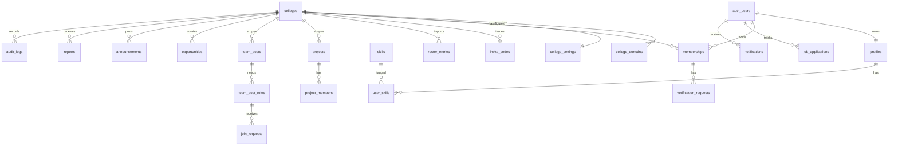

> Note: this file came from the first planning package. Old "doc NN" numbers, "T-" task IDs and Figma mentions are out of date. The task list is in ROADMAP.md. Design is built in code (see DESIGN_SYSTEM.md). Project folders are simpler now: src/contracts and src/components/ui.

# 13 - Data Model and Database

| Field | Value |
|---|---|
| Doc ID | DOC-13 |
| Version / Date | 0.1.0 / 2026-10-15 |
| Owner | R2 Tech Lead (migration owner). **Only R2 merges migrations; R5 backs up.** |
| Status | Proposed. Migration 0001 (`supabase/migrations/20261031000000_tenancy_identity_audit.sql`) implements colleges, college_domains, college_settings, profiles, memberships and audit_logs. Other tables are still design only. See section 11 for choices made while implementing. |
| Conventions | snake_case; `uuid` PKs (`gen_random_uuid()`); `created_at timestamptz default now()`, `updated_at` via trigger; soft delete via `deleted_at` only where noted; money in integer paise; enums as Postgres enums or `text` + CHECK (decision: **text + CHECK** for easier migration); every tenant-scoped table has `college_id uuid not null references colleges(id)` and **RLS enabled**. |

## 1. Entity relationship overview (P0/P1 core)

## 2. Tables - P0/P1 (full definition)
`FK` = foreign key; `UQ` = unique; `IDX` = index.

### 2.1 Tenancy and identity
**colleges**: `id` PK · `slug` text UQ (lowercase `[a-z0-9-]{3,40}`, reserved words blocked) · `name` text not null (≤120) · `short_name` text · `city`,`state` text · `country` text default 'IN' · `timezone` text default 'Asia/Kolkata' · `status` text CHECK in (`draft`,`active`,`suspended`,`archived`) · `logo_path` text · `accent_hex` text CHECK `^#[0-9A-Fa-f]{6}$` · `created_by` uuid · timestamps.
**college_domains**: `id` · `college_id` FK · `domain` text UQ (lowercase, no `@`) · `verified_at` · IDX(`college_id`). *A domain belongs to exactly one tenant.*
**college_settings**: `college_id` PK/FK · `allowed_methods` text[] (subset of `email_domain`,`invite_code`,`manual`,`roster`,…) · `require_admin_approval` bool default true · `min_level_to_post` smallint default 1 · `network_visibility` text CHECK in (`private`,`read_shared`,`full_shared`) default `private` · `features` jsonb default '{}' (flags per module) · `retention` jsonb.
**profiles**: `user_id` PK FK→auth.users · `display_name` text (1–80) · `handle` text UQ nullable (`[a-z0-9_]{3,30}`) · `headline` (≤120) · `bio` (≤1000) · `avatar_path` · `interests` text[] (≤20) · `career_goal` text · `visibility` text CHECK in (`college`,`hidden`) default `college` · `portfolio_public` bool default false · `deleted_at`.
**memberships**: `id` · `user_id` FK · `college_id` FK · UQ(`user_id`,`college_id`) · `role` CHECK in (`student`,`moderator`,`college_admin`) default `student` · `status` CHECK in (`pending`,`active`,`suspended`,`rejected`,`left`) · `verification_level` smallint 0–3 (0 none, 1 self-claimed/pending, 2 verified by institutional method, 3 verified by ID document - reserved) · `verification_method` text · `program` text · `grad_year` smallint · `enrollment_hash` text (HMAC-SHA256 with server secret) · `enrollment_last4` text · `joined_at` · `status_reason` text · `status_changed_by` uuid · IDX(`college_id`,`status`).
**platform_admins**: `user_id` PK. Access only via service role; no RLS exposure to clients.
**verification_requests**: `id` · `membership_id` FK · `college_id` FK · `method` · `status` CHECK in (`pending`,`approved`,`rejected`,`expired`,`cancelled`) · `submitted_data` jsonb (minimal; enrolment stored hashed) · `decided_by` uuid · `decided_at` · `decision_reason` · `expires_at`. IDX(`college_id`,`status`,`created_at`).
**invite_codes**: `id` · `college_id` · `code_hash` text UQ (store hash; show code once) · `label` · `created_by` · `max_uses` int · `used_count` int default 0 CHECK(`used_count<=max_uses`) · `expires_at` · `revoked_at` · `grants_status` (`active`|`pending`).
**roster_entries**: `id` · `college_id` · `batch_id` FK · `email_hash`,`enrollment_hash` · `display_name` · `program`,`grad_year` · `claimed_by` uuid null · `claimed_at` · UQ(`college_id`,`enrollment_hash`) · retention per tenant settings.
**import_batches**: `id` · `college_id` · `created_by` · `row_count`,`error_count` · `status` · `created_at`.

### 2.2 Me, projects
**skills**: `id` · `name` text UQ on lower(name) · `category` · `status` (`approved`,`pending`). Global catalog (not tenant data).
**user_skills**: PK(`user_id`,`skill_id`) · `level` smallint 1–5 · `evidence_url` text (https only) · `created_at`.
**achievements**: `id` · `user_id` · `kind` (`award`,`certification`,`other`) · `title` · `issuer` · `url` · `achieved_on`.
**projects**: `id` · `college_id` · `owner_id` · `title` (≤120) · `summary` (≤2000) · `repo_url`,`demo_url` (https) · `status` (`active`,`completed`,`archived`) · `visibility` (`college`,`portfolio_public`) · `started_on`,`ended_on` · `deleted_at`. IDX(`college_id`,`owner_id`).
**project_members**: PK(`project_id`,`user_id`) · `role_title` · `status` (`invited`,`confirmed`,`declined`) · `confirmed_at`.

### 2.3 Team Finder
**team_posts**: `id` · `college_id` · `author_id` · `kind` (`project`,`startup`,`hackathon`,`competition`) · `title` (≤120) · `description` (≤3000) · `status` (`open`,`closed`,`filled`,`expired`,`removed`) · `deadline` timestamptz · `external_link` (https) · `team_link` (visible to accepted members only; stored in separate table `team_post_private`) · `search` tsvector (generated) · IDX(`college_id`,`status`,`created_at` desc), GIN(`search`).
**team_post_roles**: `id` · `post_id` FK · `college_id` (denormalised for RLS, enforced equal by trigger/CHECK via composite FK) · `role_name` (≤60) · `slots` smallint 1–20 · `filled` smallint default 0 · CHECK(`filled<=slots`).
**team_post_role_skills**: PK(`role_id`,`skill_id`).
**join_requests**: `id` · `college_id` · `post_id` · `role_id` · `applicant_id` · `message` (≤500) · `status` (`pending`,`accepted`,`declined`,`withdrawn`,`cancelled`) · `decided_by`,`decided_at` · UQ(`role_id`,`applicant_id`) WHERE status in (`pending`,`accepted`) *(partial unique)*.

### 2.4 Career
**job_applications** (owner-only, no `college_id`): `id` · `user_id` · `company` (≤120) · `role_title` (≤120) · `source_url` · `status` (`saved`,`applied`,`assessment`,`interview`,`offer`,`rejected`,`withdrawn`) · `deadline` date · `applied_on` date · `notes` text (≤4000) · `opportunity_id` FK null · `version` int (optimistic concurrency) · timestamps · IDX(`user_id`,`status`,`deadline`).
**application_events**: `id` · `application_id` · `from_status`,`to_status` · `at` · `note`.
**opportunities**: `id` · `college_id` null (null = platform-curated, visible to tenants that enable it) · `title` · `org` · `kind` (`internship`,`job`,`hackathon`,`competition`,`scholarship`) · `location` · `mode` (`onsite`,`remote`,`hybrid`) · `stipend_min`,`stipend_max` int (paise/month, nullable) · `eligibility` text · `skills` text[] · `deadline` · `apply_url` (https) · `posted_by` · `status` (`draft`,`published`,`expired`,`removed`) · `last_verified_at`.
**saved_opportunities**: PK(`user_id`,`opportunity_id`).
**reminders**: `id` · `user_id` · `kind` · `ref_type`,`ref_id` · `remind_at` · `sent_at` · UQ(`user_id`,`kind`,`ref_id`,`remind_on`).

### 2.5 Platform support
**announcements**: `id` · `college_id` · `author_id` · `title` · `body` (≤5000) · `pinned` bool · `publish_at` · `expires_at` · `status`.
**notifications**: `id` · `user_id` · `college_id` · `type` · `payload` jsonb (no PII beyond ids/titles) · `read_at` · IDX(`user_id`,`read_at`,`created_at` desc).
**reports**: `id` · `college_id` · `reporter_id` · `target_type` · `target_id` · `reason` (enum list) · `details` (≤1000) · `status` (`open`,`dismissed`,`actioned`) · `handled_by` · `handled_at`. UQ(`reporter_id`,`target_type`,`target_id`) while open.
**moderation_actions**: `id` · `report_id` · `college_id` · `actor_id` · `action` · `reason` · `created_at`.
**blocks**: PK(`blocker_id`,`blocked_id`).
**audit_logs** (append-only): `id` bigint identity · `college_id` null · `actor_id` · `actor_role` · `action` text · `target_type`,`target_id` · `metadata` jsonb (no secrets/PII bodies) · `request_id` · `created_at`. **No UPDATE/DELETE grants; RLS select for admins of same tenant only.**
**idempotency_keys**: `key` text · `user_id` · `route` · `request_hash` · `response` jsonb · `status_code` · `expires_at` · PK(`user_id`,`key`,`route`).
**waitlist_leads**: `id` · `college_name` · `contact_name` · `contact_email` · `role` · `consent_at` · `source` · no tenant; insert-only via server; retention 12 months.
**files**: `id` · `college_id` · `owner_id` · `bucket` · `path` UQ · `mime` · `size_bytes` · `status` (`ready`,`quarantined`,`deleted`) · `created_at`.

## 3. Tables - P2/P3 (outline; full columns defined when scheduled)
`events(id,college_id,organizer_id,title,description,starts_at,ends_at,place,capacity,status)` · `event_rsvps(event_id,user_id,status)` · `lost_found_items(id,college_id,reporter_id,kind,title,description,location_text,occurred_on,photo_file_id,status)` · `lf_claims` · `marketplace_listings(id,college_id,seller_id,type,title,description,category,price_paise,rent_period,deposit_paise,condition,status,photo_file_ids)` · `listing_requests` · `conversations`,`messages` (if in-app messaging added; high moderation cost) · `notes_resources(id,college_id,uploader_id,title,course,semester,file_id,declaration_at,status)` · `activity_posts`,`activity_participants` · `skill_offers`,`skill_sessions` · `roadmaps`,`roadmap_milestones`,`daily_tasks`,`weekly_reviews`,`resumes`,`question_bank`,`practice_answers` · `reputation_events(id,college_id,subject_user_id,kind,confirmed_by,created_at)` (append-only, three signals computed in separate views) · `network_shares(a_college_id,b_college_id,scope,approved_by_both_at)`.

## 4. Tenant boundaries and RLS (summary; details doc 15)
- Helper SQL functions (`SECURITY DEFINER`, fixed `search_path`, tested): `auth_member_colleges(min_level int default 1) returns setof uuid` and `is_college_admin(cid uuid)`, `is_moderator_or_admin(cid)`.
- Pattern: `USING (college_id IN (select auth_member_colleges()))`; writes add `WITH CHECK` including ownership (`author_id = auth.uid()`).
- `job_applications`, `notifications`, `reminders`: `user_id = auth.uid()` only.
- `audit_logs`: insert only via SECURITY DEFINER function; select for tenant admins.
- Composite FKs `(post_id, college_id)` prevent a role/request pointing to another tenant's post.
- **No table is exposed to the anon role except explicit public views** (`public_college_branding`, `public_portfolio`).
- CI test: every table in `public` with a `college_id` column must have RLS enabled and ≥ 1 policy (automated check) - fail the build otherwise.

## 5. Indexes (initial set)
Tenant-first composite indexes `(college_id, …)`; GIN on `search`; partial indexes for `status='open'`; FK columns indexed; verify with `EXPLAIN` on seed data of ≥ 10k rows (T-BE-11).

## 6. Data lifecycle, retention, deletion
| Data | Retention | Deletion behaviour |
|---|---|---|
| Account/profile | Until deletion request | Anonymise: name → "Former member", remove avatar/bio, drop skills; keep authored content only if needed for others' history, anonymised |
| Posts/projects | Until owner deletes or tenant policy | Soft delete 30 days, then hard delete |
| Applications | Until user deletes | Hard delete; never shared |
| Verification requests | 12 months after decision (setting) | Hard delete; enrollment hash retained only while membership exists |
| Roster entries | Delete after claim window (default 90 days) | Hard delete |
| Audit logs | 24 months (proposed, confirm with legal) | Not deletable by tenants; anonymise actor on account deletion where permitted |
| Notifications | 90 days | Hard delete by job |
| Idempotency keys | 24 hours | Cleanup job |
| Waitlist leads | 12 months | Cleanup job |
| Backups | Provider retention (see doc 23) | Deleted data persists in backups until expiry - documented in privacy notice |
Tenant offboarding: export (JSON/CSV) → 30-day grace → hard delete.

## 7. Migrations and rollback
- Supabase CLI SQL migrations in `supabase/migrations/<timestamp>_<name>.sql`; **forward-only in production**; rollback by compensating migration, not by editing history.
- Each migration PR includes: description, lock impact, expected duration, how to verify, and a compensating script if destructive.
- Two-step for breaking changes (expand → migrate data → contract in a later release).
- CI applies all migrations on an empty DB and runs pgTAP tests; staging receives migrations before production; **backup/snapshot before every production migration** (doc 23).
- Ownership: R2 authors/approves; any teammate may propose; no one runs ad-hoc SQL in production - emergency changes via migration file with R2 + R5 approval.

## 8. Seed and test data
`supabase/seed.sql` creates: tenants **Alpha College** and **Beta Institute** (different domains), users per role per tenant (admin, moderator, 3 students each, 1 pending, 1 suspended), 1 cross-tenant lookalike (same display name) to catch leakage, ~20 team posts, 15 applications. **All fake; generated names; no real emails.** Separate `seed_large.sql` (10k+ rows) for performance checks.

## 9. Concurrency and transactions
| Operation | Technique |
|---|---|
| Accept join request / slot accounting | SQL function; `SELECT … FOR UPDATE` on role row; CHECK(`filled<=slots`) |
| Invite redemption | `UPDATE … SET used_count = used_count+1 WHERE used_count<max_uses AND revoked_at IS NULL AND expires_at>now() RETURNING` - zero rows = exhausted |
| Application edit | `version` column; `UPDATE … WHERE id=$1 AND version=$2`; zero rows → 409 |
| Duplicate submissions | Idempotency keys on create endpoints |
| Event RSVP capacity | Transaction + unique(`event_id`,`user_id`) + count check under lock |
| Last-admin removal | Trigger prevents leaving a tenant with zero admins |

## 10. Sensitive fields
Enrollment number (hashed + last4), email (auth schema only), verification submissions, application notes (private), audit metadata, future ID documents (separate private bucket, 30-day max retention, access logged). Encrypted at rest by the provider; application-level encryption only where justified by ADR.

## 11. Implementation notes (migration 0001, R2 Day 1)
Where the design was silent, R2 chose the following. Change them by a new migration and update this list.
- `colleges.status` defaults to `draft`. `country` must be two capital letters. Reserved slugs are blocked by a check (admin, api, app, auth, c, colleges, dev, docs, health, login, logout, me, p, platform, ready, signin, signup, static, waitlist, www).
- `college_settings` is created by a trigger when a college is inserted. Default join methods: `email_domain`, `invite_code`, `manual`. `roster` is allowed too. Admins can update the settings columns but not `college_id`.
- `college_domains` and `colleges` are written only by the server (service role). A domain claim is a trust decision, so a college admin cannot add one from the client.
- `memberships` has no client write rights at all. Role, status and level change only through the server. An `active` membership must have `verification_level >= 1`. A trigger blocks removing, demoting or suspending the last active admin of a college.
- A member can read only their own membership row. College admins read their whole college. Classmates do not see each other's memberships (they hold method, program and enrollment fields).
- `profiles` are visible to yourself and to people who share an **active** membership with you, unless `visibility = 'hidden'` or `deleted_at` is set. Pending and suspended people are invisible to others. Clients cannot set `deleted_at` (account deletion runs on the server).
- `memberships.college_id` and `audit_logs.college_id` use `on delete restrict`: a college with members or audit rows cannot be deleted by accident. Use `status = 'archived'`.
- `audit_logs`: clients and even the service role have no INSERT, UPDATE or DELETE right. Rows are added only through `write_audit_log(...)`, which only the service role may call. Triggers also block UPDATE, DELETE and TRUNCATE for every role, including in replica mode. `actor_id` has no foreign key on purpose, so deleting an account never blocks or rewrites history.
- `auth_member_colleges(min_level)`, `is_college_admin(cid)`, `is_moderator_or_admin(cid)` and `auth_shares_college_with(uid)` are SECURITY DEFINER with an empty `search_path`. They check membership status `active` only. They do **not** check `colleges.status`. Blocking a suspended college (`TENANT_SUSPENDED`) is the API's job on Day 2. Open question for R2 and R5.
- Local tests run with `pnpm db:test` (pgTAP, files in `supabase/tests/database`).
