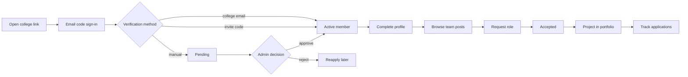

> Note: this file came from the first planning package. Old "doc NN" numbers, "T-" task IDs and Figma mentions are out of date. The task list is in ROADMAP.md. Design is built in code (see DESIGN_SYSTEM.md). Project folders are simpler now: src/contracts and src/components/ui.

# 07 - Feature Catalog and User Journeys

| Field | Value |
|---|---|
| Doc ID | DOC-07 |
| Version / Date | 0.1.0 / 2026-10-15 |
| Owner | R1 (R4 backup) |
| Status | Proposed |
| Reading guide | Feature IDs `F-nn` match doc 05. API operation IDs match doc 14. Table names match doc 13. Screens match doc 08. "POV" is written from the student's point of view. |

Common to every feature (not repeated): all endpoints require a session and an **active membership** in the tenant in the path; server-side validation; rate limits; errors use the standard envelope; each screen has loading/empty/error states; audit logging applies only to admin/moderator actions.

---
## F-01/F-02/F-03 Join, sign in and verify
- **Real problem:** anyone could claim to be a student; admins can't control who gets in.
- **POV:** "I tap my college's link, enter my email, type the code, and either I'm in or I'm told exactly what to do next."
- **Trigger/entry:** `/c/{slug}` landing (shared link, QR, ambassador).
- **Happy path:** 1 Open tenant landing (branding visible) → 2 enter email → `AUTH-01` sends code → 3 enter code `AUTH-02` → session → 4 "Verify you belong" page lists the methods this tenant enabled → 5a email on registered domain → code → `active` L2; 5b enter invite code `TEN-03`; 5c manual form (enrollment no., program, year) `TEN-04` → `pending` → 6 admin decides → notification → 7 onboarding (profile starter).
- **Alternatives/failures:** wrong/expired code (3 tries, then cool-down); email delivery delay (resend after 60 s, max 5/h); invalid/exhausted invite; domain not allowed; rejected with reason (can reapply once per 7 days); tenant suspended (notice); user already member (redirect).
- **Screens:** T01 Landing, T02 Sign-in, T03 Code entry, T04 Verify methods, T05 Pending status, T06 Rejected/retry.
- **API:** AUTH-01, AUTH-02, TEN-01, TEN-02, TEN-03, TEN-04, TEN-05.
- **Data:** `auth.users`, `profiles`, `memberships`, `verification_requests`, `invite_codes`, `college_domains`, `audit_logs`.
- **Permissions/privacy:** pending users see only tenant public info; enrollment number stored hashed + last-4 displayable to admins (doc 13); never shown to students.
- **Notifications:** decision result in-app (and email opt-in later).
- **AC:** AC-VER-002, AC-VER-003; AC-VER-004 "pending cannot call member endpoints (403 `MEMBERSHIP_NOT_ACTIVE`)".
- **Dependencies/phase:** F-01 → F-02 → F-03; Tier 0, Day 2–3.

## F-04 Roster-based verification
- **Problem:** colleges without student emails still have lists.
- **POV:** "My college already has my enrollment number; I just enter it."
- **Happy:** admin uploads CSV → preview with errors → confirm → students claim by entering enrollment number + email code (to any email) → match → `active` L2.
- **Failures:** duplicate rows (reported), already claimed (409), partial import (transaction; all-or-nothing per file), malformed CSV.
- **Screens:** A04 Roster import, T04 claim step. **API:** ADM-04, TEN-06. **Data:** `roster_entries`, `import_batches`.
- **Privacy:** minimal columns; delete roster after verification window (setting). **AC:** re-import same file changes nothing (idempotent). **Phase:** Tier 1.

## F-05/F-06 Admin console, roles, audit
- **Problem:** admins need control and accountability.
- **POV (admin):** "I can see who is waiting, approve in one click, and see who did what."
- **Happy:** Dashboard → Verification queue → open request → approve/reject (reason mandatory on reject) → audit entry. Members → change role/suspend. Settings → toggle modules.
- **Failures:** removing the last admin blocked; suspending self blocked; stale queue item (already decided → 409).
- **Screens:** A01–A08. **API:** ADM-01..ADM-12. **Data:** `memberships`, `verification_requests`, `audit_logs`, `college_settings`.
- **AC:** every state-changing admin call writes exactly one audit row; students get 403 on all `/admin` paths.

## F-07 Reports and moderation
- **Problem:** unsafe or spam content must be removable fast.
- **POV:** "I tap Report, choose a reason, and I'm told it's received."
- **Happy:** Report → queue → moderator opens target → action (dismiss/hide/warn/suspend) → reporter + author notified (neutral wording) → audit.
- **Failures:** duplicate reports merged; self-report blocked; moderator conflict of interest (cannot act on own content).
- **Screens:** S-Report dialog, M01 Queue, M02 Detail. **API:** RPT-01..RPT-04. **Data:** `reports`, `moderation_actions`, `audit_logs`.
- **AC:** AC-RPT-002.

## F-08 Notifications
- In-app bell with unread count; types: verification decision, join request received/decided, report outcome, reminder.
- **API:** NTF-01 list, NTF-02 mark read. **Data:** `notifications`. **AC:** notifications only visible to recipient (RLS).

## F-09 Profile and skills
- **Problem:** no consistent identity for the student's skills.
- **POV:** "I fill my headline and add skills; I decide who sees my profile."
- **Happy:** Me → Edit profile → add skills (autocomplete from catalog; new skills go to a moderated list) → save → view as others see it.
- **Failures:** avatar too large/invalid type; duplicate skill; profile hidden → not in directory.
- **Screens:** Me01 Profile, Me02 Edit, Me03 Skills. **API:** PRF-01..PRF-04. **Data:** `profiles`, `skills`, `user_skills`.
- **AC:** hidden profile never appears in `PRF-05` directory results.

## F-10 Portfolio and projects
- **Problem:** proof of work is scattered.
- **POV:** "I add my project once; it shows on my profile and portfolio."
- **Happy:** Me → Projects → New → title, summary, links, role, dates → add teammates (they confirm) → toggle "show on portfolio" → share link `/p/{handle}`.
- **Failures:** invalid URL scheme (only https), teammate declines, public link while profile hidden (blocked with explanation).
- **API:** PRJ-01..PRJ-07, PRF-06. **Data:** `projects`, `project_members`, `portfolio_settings`. **AC:** public portfolio exposes only fields marked public; no email, phone, enrollment.

## F-11 Team Finder
- **Problem:** finding the right teammates quickly.
- **POV (poster):** "I post what we're building and the roles I need."
- **POV (applicant):** "I see posts matching my skills and request a role."
- **Happy:** Collaborate → New post → roles/slots/skills/deadline → publish → others browse (filters) → open → "Request to join" with message → poster gets notification → Accept/Decline → applicant notified → slots update → post auto-closes when full.
- **Failures:** duplicate request (409); role full (409 `SLOTS_FULL`); poster leaves tenant; deadline passes (status `expired`); applicant withdraws after acceptance (frees slot; audit by system).
- **Screens:** C01 Browse, C02 Detail, C03 Create/Edit, C04 My posts, C05 Requests. **API:** TMF-01..TMF-09. **Data:** `team_posts`, `team_post_roles`, `team_post_role_skills`, `join_requests`.
- **Privacy:** contact details never shown; collaboration happens via an agreed external channel after acceptance (poster may add a "team chat link" visible to accepted members only).
- **AC:** AC-TMF-004. **Phase:** Tier 1, Day 4.

## F-12 Contribution history
- Auto-records: accepted team memberships, confirmed project roles. Shown on Me → Contributions (separate from career section). **Data:** derived view over `project_members`, `join_requests`. **AC:** unconfirmed claims never appear.

## F-13 Application Tracker
- **Problem:** lost deadlines and forgotten follow-ups.
- **POV:** "I paste the job link, set a deadline, and move it along as things happen."
- **Happy:** Career → Tracker → Add → company, role, link, deadline → status changes (timestamped) → filter/sort by deadline → add notes.
- **Failures:** invalid link; deadline in past (warn, allow); concurrent edit on two devices (last-write-wins with `updated_at` conflict check → 409 and refresh prompt).
- **API:** APP-01..APP-06. **Data:** `job_applications`, `application_events`. **Privacy:** owner-only RLS. **AC:** AC-APP-004.

## F-14 Curated opportunities
- **Problem:** discovery lives on scattered sites; no source of truth here.
- **POV:** "My college's placement cell posts verified opportunities; I filter and save."
- **Happy:** Career → Opportunities → filters (type, skills, location, stipend, eligibility, deadline) → Save → optional "Add to tracker".
- **Failures:** expired; broken link report; admin edits after student saved (student sees updated info + "changed" badge).
- **API:** OPP-01..OPP-06. **Data:** `opportunities`, `saved_opportunities`. **Rule:** no scraping; each listing has a posted-by and last-verified date.

## F-15 Reminders
- Daily scheduled job creates in-app notifications for deadlines within 48 h; opt-out per user. **Data:** `reminders`. **Failure:** job failure → logged, retried next run; duplicates prevented by unique (user, ref, date).

## F-16 Announcements
- Admins/moderators post; students read. Pinned first, expired hidden. **API:** ANN-01..ANN-05. **AC:** students cannot create (403).

## F-17 Lost & Found
- **Problem:** items lost, notice boards ineffective.
- **Happy (lost):** Post lost item with photo/location/date → finder sees → "I found this" → owner confirms → mark resolved. **(found):** post found with photo that hides identifying details → owner claims with description → finder verifies → resolved.
- **Failures:** false claims (claim requires describing hidden detail), spam, photo containing personal data (guidance + report), auto-archive after 60 days (setting).
- **API:** LNF-01..LNF-06. **Data:** `lost_found_items`, `lf_claims`. **Privacy:** contact stays in-app.

## F-18 Events
- Create/RSVP/cancel; capacity; reminder; attendee list visible to organiser only. **API:** EVT-01..EVT-06. **Data:** `events`, `event_rsvps`. **Failure:** over-capacity race → transaction with unique + count check.

## F-19 Marketplace (rent/buy/sell/free/wanted)
- **Problem:** passing things on safely.
- **Happy:** List item (photos, price display, condition, availability, pickup area) → buyer "Request" with message → seller accepts → both see agreed contact method chosen by each → meet in public place (safety tips) → seller marks closed → both can leave a **private** feedback note (feeds future reputation signal only if confirmed by both).
- **Failures:** no-show; dispute (report → moderator; platform does not mediate money); prohibited items (list in rules; auto keyword flag); fake listing (report).
- **Explicit exclusions:** no payment, no escrow, no shipping.
- **API:** MKP-01..MKP-08. **Data:** `marketplace_listings`, `listing_requests`. **Phase:** Tier 2, defer (high trust burden).

## F-20 Notes and resources
- Upload files or links with subject/course/semester; declare "I own or may share this"; download count (privacy-safe); report copyright → takedown within a defined SLA. **API:** NTE-01..NTE-06. **Data:** `notes_resources`, storage bucket `notes` (private, signed URLs). **Failure:** malware/oversized/invalid type → rejected; storage quota reached → graceful error.

## F-21 Activities / Turf
- Post an activity (sport, time, venue, spots) → members join/leave → full → closed; reminder to joined. **API:** ACT-01..ACT-05. **Data:** `activity_posts`, `activity_participants`.

## F-22 Skill Exchange
- Post "I can teach X / want to learn Y"; matcher lists complementary posts (simple query by skill overlap); both agree → session record; confirmed sessions feed contribution history. **API:** SKX-01..SKX-05.

## F-23..F-26 Career tools (Tier 2–3)
- **Resume:** structured from profile; rule-based checks (length, verbs, missing sections); export PDF; no AI. **Roadmap:** target role → milestones from a curated template library; progress by completion. **Daily plan:** 3 tasks selected from roadmap/applications; unfinished tasks roll to next day. **Weekly review:** counts + recurring gaps. **Interview practice:** question bank by role; saved answers; self-rating. **AI** is out of scope until ADR-010 criteria are met.

## F-27 Reputation (three signals) - Tier 3
- Community signal from **second-party-confirmed** events only; skills from evidence; readiness private. Anti-gaming rules in doc 02 §7. Built only after real data.

## F-28 Cross-college network - Tier 3
- Per-tenant `network_visibility`; both tenants must opt in for any sharing; read-only first; default off; every query goes through an explicit `network_shared` view, never by loosening tenant RLS.

## F-29 Anonymous community - Tier 3
- Requires: moderation tooling, report-reveal policy (who can see authorship), abuse rate limits, legal advice. Not designed further now.

## F-30 Student-ID upload - Tier 3
- Sensitive document; requires private bucket, short retention (delete after review), reviewer access logging, DPDP assessment. Not before beta feedback proves need.

## F-31/F-32 Landing, waitlist, analytics
- Landing: value proposition, "Request StudentOS for your college" form (college name, role, contact) → `waitlist_leads`; privacy notice link. Analytics per doc 06 §11.

---
## Journey maps

