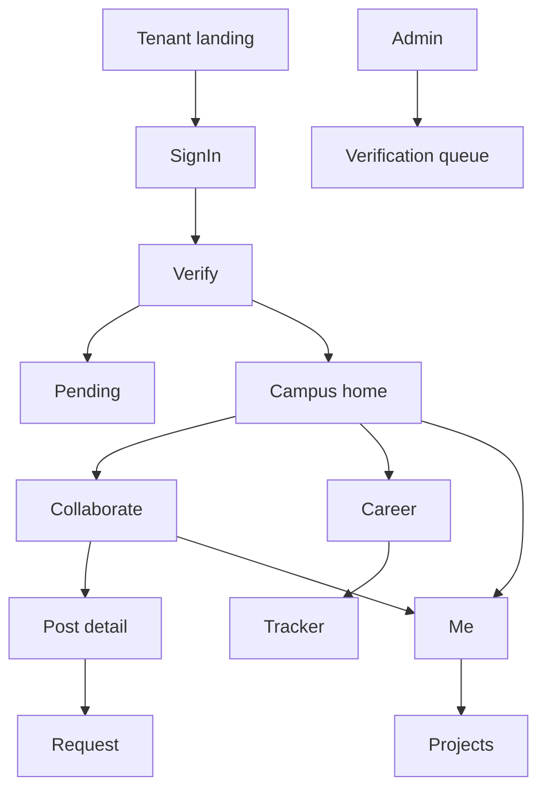

> Note: this file came from the first planning package. Old "doc NN" numbers, "T-" task IDs and Figma mentions are out of date. The task list is in ROADMAP.md. Design is built in code (see DESIGN_SYSTEM.md). Project folders are simpler now: src/contracts and src/components/ui.

# 08 - Information Architecture and Navigation

| Field | Value |
|---|---|
| Doc ID | DOC-08 |
| Version / Date | 0.1.0 / 2026-10-15 |
| Owner | R4 UX/UI (R3 backup) |
| Status | Proposed |

## 1. Main navigation (source recommendation, SRC S1 p.9)
Four top-level destinations: **Campus · Collaborate · Career · Me**. A fifth, **Admin**, appears only for admins/moderators. Mobile: bottom tab bar (4 + overflow). Desktop: left rail with the same four plus search and notifications. Disabled modules (flag off) are **removed from navigation**, not greyed out.

Layered growth (REC): new members see Campus + Collaborate + Me; Career is introduced after the student sets a career goal or taps "Career".

## 2. Route inventory
Public: `/` landing · `/c/{slug}` tenant landing · `/p/{handle}` public portfolio · `/legal/*` (privacy, terms) · `/status`.
Auth: `/c/{slug}/sign-in` · `/c/{slug}/verify` · `/c/{slug}/pending`.
Member (all under `/c/{slug}`):
| Area | Routes |
|---|---|
| Campus | `/campus` (feed: announcements first) · `/campus/announcements/[id]` · `/campus/events` `/events/[id]` · `/campus/lost-found` `/[id]` `/new` · `/campus/market` `/[id]` `/new` · `/campus/notes` `/[id]` `/new` · `/campus/activities` |
| Collaborate | `/collaborate` · `/collaborate/posts/[id]` · `/collaborate/new` · `/collaborate/mine` · `/collaborate/requests` · `/collaborate/skills` |
| Career | `/career` · `/career/tracker` `/tracker/[id]` · `/career/opportunities` `/[id]` · `/career/roadmap` `/plan` `/resume` `/practice` `/review` (flagged) |
| Me | `/me` · `/me/edit` · `/me/skills` · `/me/projects` `/[id]` · `/me/achievements` · `/me/privacy` · `/me/notifications` · `/people` `/people/[id]` |
| Admin | `/admin` · `/admin/verification` · `/admin/members` · `/admin/invites` · `/admin/roster` · `/admin/content` · `/admin/reports` · `/admin/settings` · `/admin/audit` |
Platform: `/platform` (staff only, separate auth role) · `/platform/colleges` · `/platform/colleges/[id]`.

## 3. Module boundaries (frontend folders)
`features/{tenancy,auth,verification,admin,profile,projects,team-finder,tracker,opportunities,announcements,events,lost-found,market,notes,activities,reports,notifications}`. Each owns its components, hooks, API client, and tests; cross-feature imports go through the feature's `index.ts` only.

## 4. Screen relationship map

## 5. State patterns (required on every data screen)
| State | Rule |
|---|---|
| Loading | Skeleton matching layout; never spinner-only for lists; timeout after 10 s → error state |
| Empty | Explain what belongs here + a primary action; for a new tenant, show helpful starter content (e.g. "Post the first team request") |
| Error | Plain-language message, retry button, error code (request id) for support |
| Success | Inline confirmation (toast ≤ 4 s) plus visible result |
| Offline | Banner "You're offline"; forms keep drafts locally; no silent failures |
| Forbidden | Explains why and what to do (e.g. "Waiting for verification") |
| Suspended tenant | Full-page notice |

## 6. Responsive behaviour
360–599 px: single column, bottom nav, sheets for filters. 600–1023: two columns, rail collapsed. ≥1024: rail + content + optional detail pane. No horizontal scrolling except in tables inside their own scroll container.

## 7. Search
v1: per-module filters + Postgres full-text on posts/people/opportunities within the tenant. Global search is T2. External search service is **not** used until needed (ADR-006).

## 8. Deep links
All detail routes are shareable only to signed-in members of the same tenant; unauthenticated visitors are redirected to tenant landing with `next` param (validated against allowlist to avoid open redirects).
